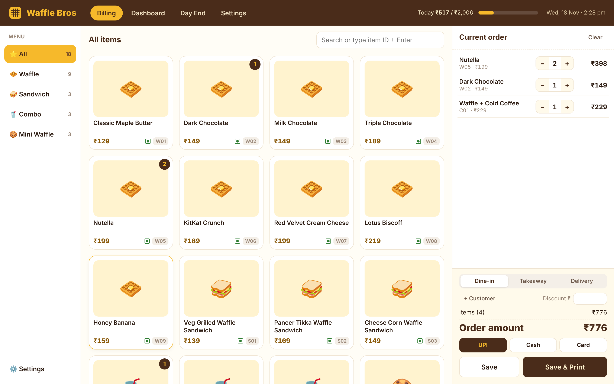
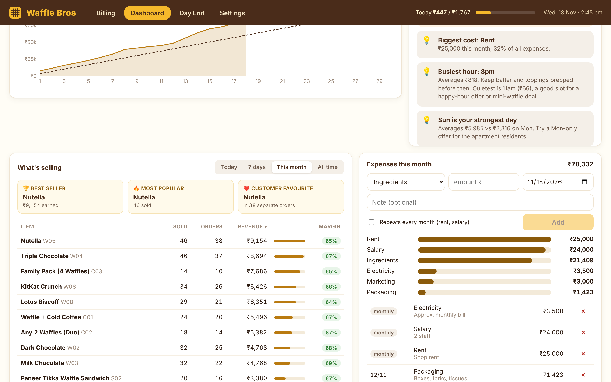

# 🧇 Waffle Bros POS

A point-of-sale and revenue-target dashboard for **Waffle Bros, Bhopal**. It runs on the shop computer, needs no internet for billing, and can be opened from a tablet or phone on the shop Wi-Fi.

What makes it different from a regular POS: you set a **monthly revenue target** (say ₹1,00,000) and the app tells you, every day, how close you are, what today's goal is, and what to do to get there, with your running expenses taken into account.

## Screens





_Screenshots use the sample data from `uv run python -m waffle_pos.demo`._

| Screen | What it does |
| --- | --- |
| **Billing** | Category menu (Waffle, Sandwich, Combo, Mini Waffle), item cards with photo, name, price and ID, live bill on the right with the order amount. Dine-in / takeaway / delivery, UPI / cash / card, discount, optional customer, Save or Save & Print (80 mm thermal bill). Today's progress is always visible in the top bar. |
| **Dashboard** | Target ring (month progress vs an even pace), today's goal bar, amount needed per day from tomorrow, projected month end, expenses, net profit. Sales charts (hourly vs an average day, daily with target line, running total vs target pace, weekly, monthly vs target). Best seller, most popular, customer favourite, every item's sales and margin. Expense entry (one-off or monthly). Plain-language insights. |
| **Day End** | Any day's sales, orders, average bill, cash/UPI/card split, items sold, items that didn't sell, every bill (with cancel). |
| **Admin** | Behind a PIN (open it from the top bar, or go to `#admin`). **Menu**: add, edit, rename, reorder and hide categories and items, photos, prices, ingredient cost for margins. **Modules**: switch features on or off and change their settings (shop details, colours, billing options, targets, GST, discounts, Google Sheet sync). **Security**: change the PIN. **Backup**: download the database. |

## Admin dashboard

Menu changes, settings and backups are behind an admin PIN, so staff at the counter can bill but can't change prices. Billing, the dashboard and day-end stay open.

- The PIN is **1234** on a new install. Sign in with it once and the dashboard asks you to choose your own (4 to 8 digits). Do this on the first day.
- Changing the PIN signs everyone out of the admin dashboard, on every device.
- Sign-in lasts 12 hours on that device.
- Features are **modules** you switch on or off under **Admin → Modules**: GST (off until you switch it on), discounts (on, at most 20% of a bill by default), Google Sheet sync (off), and WhatsApp orders (phase 2). Shop details, colours, billing options and targets are always on.

## How the target maths works

The maths lives in `src/waffle_pos/services/targets.py` as pure functions with unit tests.


- **Today's goal** = (monthly target − sales before today) ÷ days left including today. It's fixed for the day, so the bar fills as you bill.
- **Needed per day from tomorrow** = what's still left after today's sales ÷ remaining days.
- **Projected month end** = sales so far + your average daily sales × days left. Averages count from your first sale of the month, so opening mid-month doesn't drag it down.
- **Expenses** = one-off expenses dated this month + every monthly expense (rent, salary) added in or before this month. **Break-even/day** = monthly expenses ÷ days in the month.
- **Best seller** = most revenue. **Most popular** = most units sold. **Customer favourite** = appears in the most separate bills.

## Running it with Docker (recommended)

Install [Docker Desktop](https://www.docker.com/products/docker-desktop/) on the shop computer, then from this folder:

```bash
docker compose up -d --build     # first time, and after every update (git pull)
```

The POS is at http://localhost:4000 (and on tablets via the computer's Wi-Fi address). It restarts by itself after a reboot. Useful commands:

```bash
docker compose logs -f           # see what it's doing
docker compose down              # stop it (your data stays)
docker compose pull && docker compose up -d --build   # update after a git pull
```

- **Data** lives in the Docker volume `pos-data` (`/data/waffle-bros.db` inside the container) and survives rebuilds and updates. Download a copy any time from **Admin → Backup**.
- **Google Sheet key:** put the service-account JSON in `./secrets/`, then enter `/secrets/<file>.json` as the key path in **Admin → Modules → Google Sheet sync** (see [Google Sheet sync](#google-sheet-sync)).
- **Time zone:** `WB_TIMEZONE` in `compose.yaml` (default Asia/Kolkata).

## Running it without Docker

You need **[uv](https://docs.astral.sh/uv/)** (it installs the right Python by itself) and, to build the screens once, **Node.js 22**.

**Windows:** double-click `start-pos.bat`. The first run sets everything up, then the POS opens at http://localhost:4000.

**macOS / Linux:** `./start-pos.sh`

Or by hand:

```bash
uv sync                                  # creates .venv with Python 3.12 and all dependencies
(cd frontend && npm ci && npm run build) # build the screens once
uv run waffle-pos                        # http://localhost:4000 (also prints the Wi-Fi address for tablets)
```

API docs are at http://localhost:4000/docs.

Settings for the server process come from environment variables or a `.env` file: `WB_DATA_DIR`, `WB_PORT`, `WB_TIMEZONE` (default `Asia/Kolkata`), `WB_SYNC_INTERVAL_SECONDS`.

### Try it with sample data

```bash
uv run python -m waffle_pos.demo                 # ~6 weeks of made-up sales in data-demo/ (WB_DEMO_DIR to change; real data is never touched)
WB_DATA_DIR=data-demo uv run waffle-pos          # Windows: set WB_DATA_DIR=data-demo && uv run waffle-pos
```

## Development

See `CLAUDE.md` for architecture and conventions, and `docs/API.md` for the full API reference (also live at http://localhost:4000/docs).

```bash
uv sync                       # dev tools included
uv run pre-commit install     # ruff, ruff-format, mypy and pytest before every commit
uv run ruff check && uv run ruff format --check
uv run mypy                   # strict
uv run pytest                 # with coverage
uv run uvicorn waffle_pos.app:create_app --factory --reload --port 4000   # API with auto-reload
cd frontend && npm run dev    # screens with hot reload on :5173, proxied to the API
```

Database changes: edit `src/waffle_pos/db/models.py`, then `uv run alembic revision --autogenerate -m "what changed"`. The app applies pending migrations on start-up.

CI (GitHub Actions) runs the same checks plus the front-end build on every pull request.

## Google Sheet sync

When it's switched on, the POS copies your bills, items sold and expenses to a Google Sheet every few minutes while the computer is online, so you can look at the numbers from anywhere. Billing never waits for the internet; anything not yet copied catches up later.

### Setting it up (once)

1. In the [Google Cloud console](https://console.cloud.google.com/), create a project (any name), then **enable the Google Sheets API** for it.
2. Under **IAM & Admin → Service accounts**, create a service account. Open it, go to **Keys → Add key → Create new key → JSON**, and save the downloaded file. Keep this file private: it works like a password.
3. Note the service account's email address (it ends in `.iam.gserviceaccount.com`).
4. Create a Google Sheet (or use an existing one) and **Share** it with that email address as **Editor**.
5. Put the key file on the POS computer:
   - **Docker:** copy it into the `secrets/` folder next to `compose.yaml`. Its path for the POS is `/secrets/<file>.json`.
   - **Without Docker:** anywhere on the computer; use its full path.
6. In the POS, open **Admin → Modules → Google Sheet sync**. Paste the **spreadsheet ID** (the long code in the sheet's address between `/d/` and `/edit`) and the **key file path**, switch the module on, save, and press **Sync now**.

If something is wrong, Sync now says what (for example a wrong path, or the sheet not shared with the service account).

### What it writes

| Tab | How | What's in it |
| --- | --- | --- |
| `Orders` | New rows added | One row per bill. A cancelled bill is added again with status `cancelled`. |
| `OrderItems` | New rows added | One row per item on each bill. |
| `Expenses` | New rows added | Every expense you enter. |
| `Daily` | Rewritten each sync | Last 90 days: revenue, orders, average bill, top item. |
| `Items` | Rewritten each sync | Every menu item with its last 30 days: units, bills, revenue, share of sales and margin. |
| `Monthly` | Rewritten each sync | Last 12 months: target, revenue, orders, average bill, % of target, expenses, net profit. |

The POS creates any of these tabs that are missing and never touches other tabs, so you can add your own, such as an **Overview** tab with KPI formulas and charts built on the tabs above.

## Backups

All data lives in `data/waffle-bros.db` (SQLite). **Admin → Backup** downloads a consistent copy, even while the shop is billing.

## Project layout

```
src/waffle_pos/
  app.py            FastAPI app factory (routes, error format, serves frontend/dist)
  __main__.py       `uv run waffle-pos`
  config.py         process settings (WB_* env vars)
  clock.py          shop-local time helpers
  schemas.py        Pydantic request/response models
  api/              thin routers: menu, orders, dashboard, finance, system, admin
  modules/          switchable features (shop, theme, billing, targets, GST, discounts, Sheets, WhatsApp) and their settings
  services/         business logic: orders, menu, auth (admin PIN), targets (pure maths), analytics, insights
  db/               SQLAlchemy models, session, migrations runner, starter menu
  migrations/       Alembic
  integrations/     Google Sheets sync
  demo.py           demo data generator
tests/              pytest: API, target maths, analytics, Sheets sync (mocked)
frontend/           React + Vite screens
```

## Phase 2: WhatsApp ordering (planned)

Orders already carry `source` (`counter` / `whatsapp`), `order_type` (`delivery`) and `delivery_address` fields, and `POST /api/integrations/whatsapp` is reserved for the WhatsApp Business webhook. Online orders from the apartment residents will land on the same dashboard and count toward the target.
