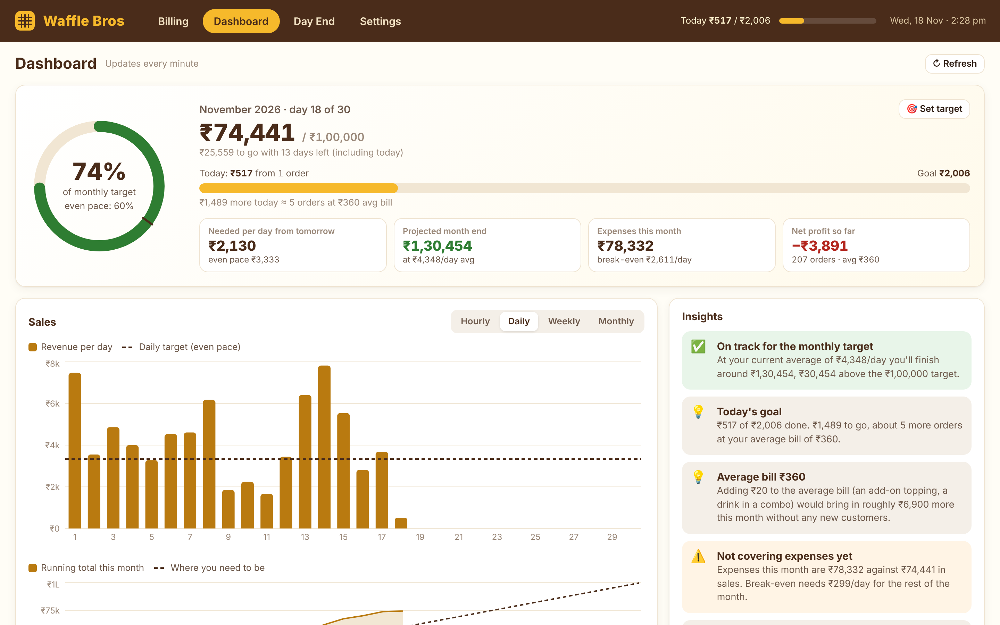

# 🧇 Waffle Bros POS

A point-of-sale and revenue-target dashboard for **Waffle Bros, Bhopal**. It runs on the shop computer, needs no internet for billing, and can be opened from a tablet or phone on the shop Wi-Fi.

What makes it different from a regular POS: you set a **monthly revenue target** (say ₹1,00,000) and the app tells you, every day, how close you are, what today's goal is, and what to do to get there, with your running expenses taken into account.

## Screens





_Screenshots use the sample data from `npm run demo`._

| Screen | What it does |
| --- | --- |
| **Billing** | Category menu (Waffle, Sandwich, Combo, Mini Waffle), item cards with photo, name, price and ID, live bill on the right with the order amount. Dine-in / takeaway / delivery, UPI / cash / card, discount, optional customer, Save or Save & Print (80 mm thermal bill). Today's progress is always visible in the top bar. |
| **Dashboard** | Target ring (month progress vs an even pace), today's goal bar, amount needed per day from tomorrow, projected month end, expenses, net profit. Sales charts (hourly vs an average day, daily with target line, running total vs target pace, weekly, monthly vs target). Best seller, most popular, customer favourite, every item's sales and margin. Expense entry (one-off or monthly). Plain-language insights. |
| **Day End** | Any day's sales, orders, average bill, cash/UPI/card split, items sold, items that didn't sell, every bill (with cancel). |
| **Settings** | Menu editor (add/edit items and photos, prices, ingredient cost for margins, hide items), shop details and GST, Google Sheet sync, backup download. |

## How the target maths works

- **Today's goal** = (monthly target − sales before today) ÷ days left including today. It's fixed for the day, so the bar fills as you bill.
- **Needed per day from tomorrow** = what's still left after today's sales ÷ remaining days.
- **Projected month end** = sales so far + your average daily sales × days left. Averages count from your first sale of the month, so opening mid-month doesn't drag it down.
- **Expenses** = one-off expenses dated this month + every monthly expense (rent, salary) added in or before this month. **Break-even/day** = monthly expenses ÷ days in the month.
- **Best seller** = most revenue. **Most popular** = most units sold. **Customer favourite** = appears in the most separate bills.

## Running it

Requires **Node.js 22.13 or newer** (https://nodejs.org, the LTS installer is fine). No database server is needed; data is one SQLite file in `data/`.

**Windows:** double-click `start-pos.bat`. The first run installs and builds (about a minute), then the POS opens at http://localhost:4000.

**macOS / Linux:** `./start-pos.sh`

Or by hand:

```bash
npm run setup   # first time: install + build
npm start       # http://localhost:4000 (the console also prints the Wi-Fi address for tablets)
```

### Try it with sample data

```bash
npm run demo        # creates ~6 weeks of made-up sales in data-demo/ (your real data/ is untouched)
npm run start:demo  # opens the POS on the demo data
```

### Developing

```bash
npm run dev   # API on :4000 with auto-reload + Vite on :5173 with hot reload
```

## Google Sheet sync

Every 5 minutes, when the computer is online, new bills, items sold and expenses are appended to a Google Sheet and a **Daily** summary tab is refreshed. Billing never waits for the internet; unsynced rows catch up later. Setup steps are in **Settings → Google Sheet** (service account key + share the sheet with it). You can also run `npm run sync` once by hand.

Tabs created: `Orders`, `OrderItems`, `Expenses`, `Daily`.

## Backups

All data lives in `data/waffle-bros.db`. Download a copy from **Settings → Backup** every week, or copy that file while the POS is closed.

## Project layout

```
server/
  index.js      Express API + serves the built front end
  db.js         SQLite schema, settings, starter menu
  analytics.js  target maths, charts, item stats, insights, day-end report
  sheets.js     Google Sheets sync (no extra packages)
  seed-demo.js  demo data generator
client/src/
  pages/        Billing, Dashboard, DayEnd, Settings
  components/   Receipt (print layout)
```

## Phase 2: WhatsApp ordering (planned)

Orders already carry `source` (`counter` / `whatsapp`), `order_type` (`delivery`) and `delivery_address` fields, and `POST /api/integrations/whatsapp` is reserved for the WhatsApp Business webhook. Online orders from the apartment residents will land on the same dashboard and count toward the target.
