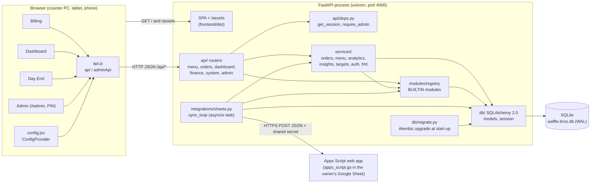
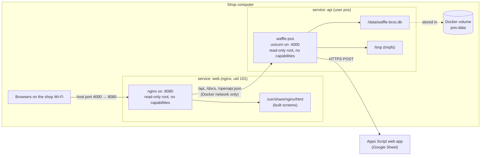
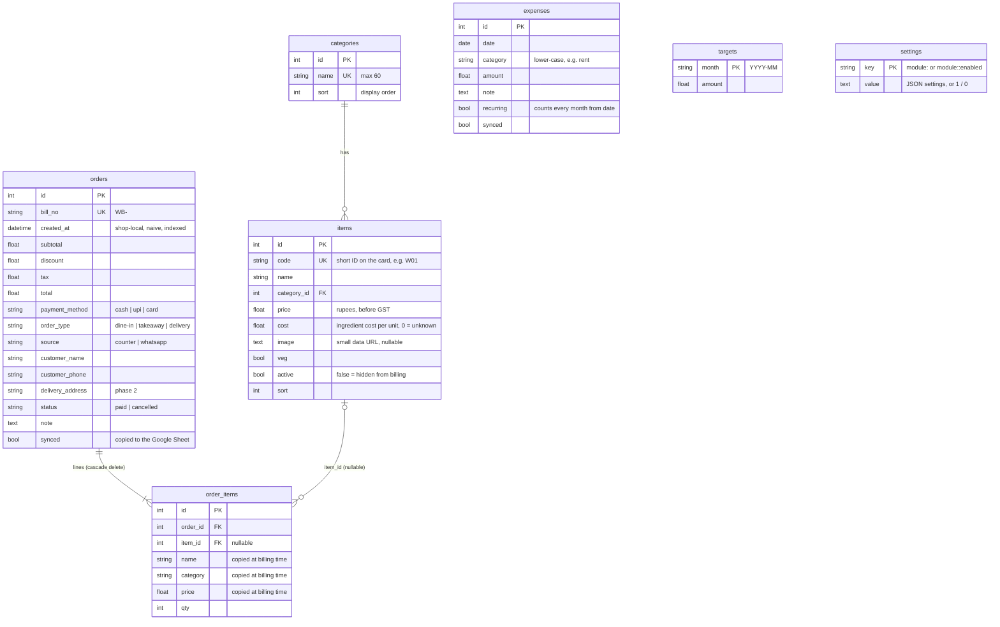
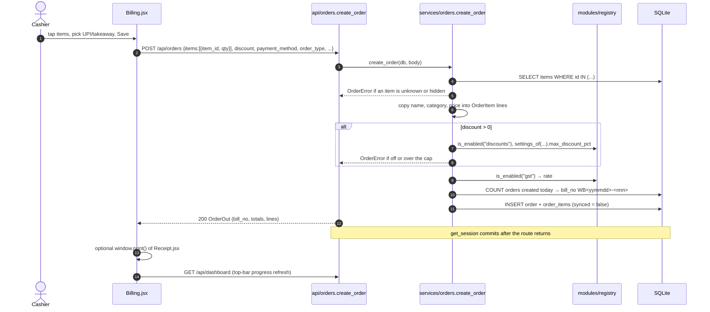
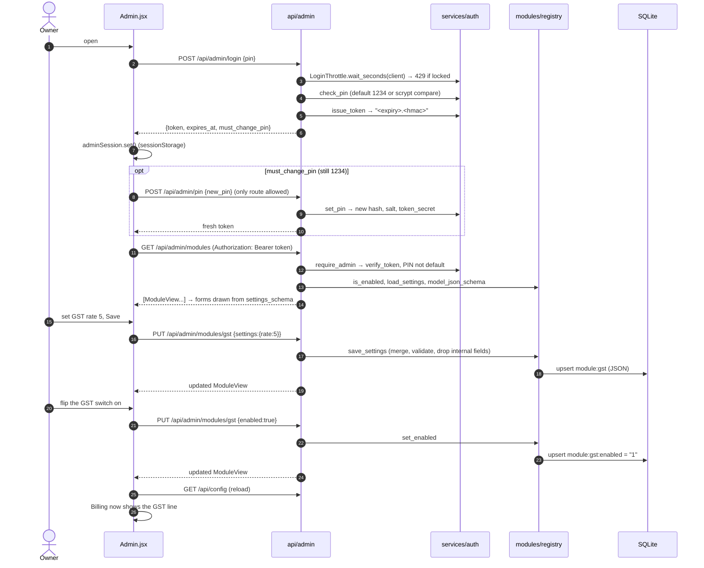
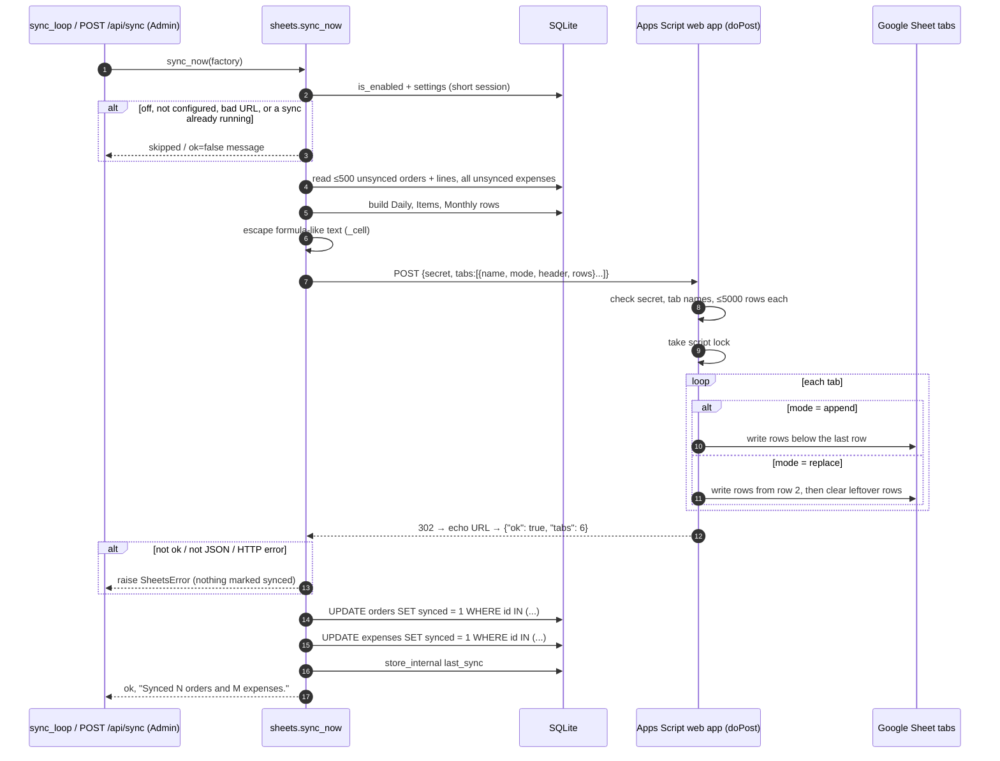

# Architecture

How the Waffle Bros POS is put together, and why. This page is for Abhinav and for future Claude
sessions. For hands-on steps (setup, recipes, tests) see [IMPLEMENTATION.md](IMPLEMENTATION.md);
for every endpoint see [API.md](API.md).

## Contents

1. [Context](#context)
2. [Components](#components)
3. [Layers and their rules](#layers-and-their-rules)
4. [Data model](#data-model)
5. [Module system](#module-system)
6. [Auth](#auth)
7. [Google Sheet sync](#google-sheet-sync)
8. [Request flows](#request-flows)
9. [Decisions and trade-offs](#decisions-and-trade-offs)
10. [Known limits](#known-limits)

## Context

- **One shop, one computer.** Waffle Bros in Bhopal runs the POS on the shop computer. The counter
  uses it in a browser on that computer. Tablets and phones on the shop Wi-Fi open
  `http://<computer's Wi-Fi address>:4000`. In Docker that port is the `web` service (nginx),
  which serves the screens and forwards `/api` to the `api` service (see
  [Deployment](#deployment-docker)). Run outside Docker, `uv run waffle-pos` listens on
  `0.0.0.0:4000` itself (`config.AppConfig.host` / `port`) and prints the Wi-Fi address
  (`__main__._lan_ip`).
- **Local-first, works offline.** Billing, the dashboard, day-end and admin need only the local
  server and its SQLite file. Nothing on the billing path calls the internet.
- **Google Sheet as a remote mirror.** When the `google_sheets` module is on, a background loop
  sends bills, bill lines and expenses to a Google Apps Script web app that lives inside the
  owner's Google Sheet. The script appends them to tabs and rewrites three summary tabs. The
  owner can then check the numbers from anywhere. The sheet is a copy for reading. The POS never
  reads from it, and a sync failure never blocks billing. Rows that weren't copied are sent on
  the next run.
- **No accounts, no cloud services.** The only outside service is the optional Apps Script web
  app. It needs no Google Cloud project or service-account key, only a shared secret.

## Components

What runs in the process (`app.create_app`):

- **Lifespan start-up:** `db.migrate.upgrade_to_head` applies pending Alembic migrations, then
  `db.seed.seed_if_empty` writes the starter menu (5 categories, 20 items: the launch menu) on a new database, then
  the sheets `sync_loop` starts as an asyncio task if `config.start_sync_loop` is true (tests turn
  it off).
- **Middlewares** (`security.py`), outermost first: `HostCheck` (refuses unknown `Host` names,
  against DNS rebinding), `BodyLimit` (413 over `WB_MAX_BODY_BYTES`) and `SecurityHeaders` (CSP,
  `X-Frame-Options`, `nosniff`, `Referrer-Policy`, `no-store` on `/api`). See
  [SECURITY.md](SECURITY.md#middlewares-securitypy-added-in-appcreate_app).
- **Routers** for `/api/*`, with one database transaction per request (`deps.get_session`).
- **Login throttle:** one `services.auth.LoginThrottle` in `app.state.login_throttle`, kept in
  memory.
- **Error format:** handlers turn every `HTTPException` into `{"error": "..."}` and every
  validation error into `{"error": "field: reason"}` with status 422. An `OverflowError` (an id too
  big for SQLite) becomes 404 `Not found`. The screens show `error` as-is.
- **Static screens (outside Docker only):** in Docker the `api` image has no screens; `web`
  serves them. Run on its own, if `frontend/dist/index.html` exists, `/assets` is mounted and every other
  path falls back to `index.html` (the screens use hash routing: `#billing`, `#dashboard`,
  `#dayend`, `#admin`). Unknown `/api/*` paths still answer a JSON 404. If it doesn't exist, `/` returns a "Front end not built yet" page.
  The check runs once, when the app is created.

### Deployment (Docker)

- **`api`** (root `Dockerfile`): `uv sync --locked --no-dev` builds the venv, and a slim Python 3.12
  runtime runs as the non-root user `pos`. Env in the image: `WB_DATA_DIR=/data`, `WB_HOST=0.0.0.0`,
  `WB_PORT=4000`, `WB_TIMEZONE=Asia/Kolkata`. `VOLUME /data`. `HEALTHCHECK` polls `/api/health`.
  It is not published on the host: only `web` can reach it.
- **`web`** (`frontend/Dockerfile`, build context `frontend/`): Node 22 builds the screens, then
  `nginxinc/nginx-unprivileged` serves them on 8080 with `frontend/nginx.conf`. `/api/*`, `/docs`,
  `/redoc` and `/openapi.json` are proxied to `api:4000`; everything else falls back to
  `index.html`. It looks `api` up through Docker's DNS on each request (cached 10 s), so a rebuilt
  `api` container is found without restarting `web`. It passes the `Host` header through unchanged
  (the API's `HostCheck` sees what the tablet typed) and **overwrites** `X-Forwarded-For` with the
  real client address. The API's own security headers cover `/api` and `/docs`;
  `frontend/security-headers.inc` adds the same ones (same CSP as `security.APP_CSP`) to the
  screens' files. The image also has a `dev` stage (the Vite dev server) used only by `make dev`.
- **Client addresses:** uvicorn runs with `proxy_headers=True` and `forwarded_allow_ips` from
  `WB_FORWARDED_ALLOW_IPS` (default `127.0.0.1`). Compose sets `*` for `api`, which is safe because
  only `web` can reach it. That way the login throttle counts wrong PINs per tablet, not per proxy.
- **`compose.yaml`** publishes `4000:8080` on `web` (never port-forward it; use
  `127.0.0.1:4000:8080` to keep it on the PC). `web` starts once `api` is healthy. Both have
  `restart: unless-stopped`, `read_only: true` with a tmpfs at `/tmp` (the backup file for `api`,
  pid and buffers for nginx), `cap_drop: [ALL]` and `no-new-privileges:true`. `api` mounts the named
  volume `pos-data` at `/data`. No key files or secrets are mounted: the Sheet sync's URL and secret
  live in the database.
- **`compose.dev.yaml`** (`make dev`, project `waffle-bros-dev`) swaps in uvicorn `--reload` on the
  bind-mounted `src/` (via `PYTHONPATH`), the Vite dev server on 5173 with the source mounted, the
  API on host port 8000, and its own `pos-dev-data` volume. Images are tagged `:dev`, so it never
  replaces the shop's images or data.

## Layers and their rules

| Layer | Where | Rule |
| --- | --- | --- |
| Routers | `src/waffle_pos/api/` | Thin. Parse input, call a service, return a schema. Every route has `summary=`, a docstring and `responses=errors(...)`, because `docs/openapi.json` is generated from them and `tests/test_openapi.py` checks it. |
| Dependencies | `api/deps.py` | `DB` (one session per request, committed on success, rolled back on error), `SessionFactory` (for the async sync endpoint), `AdminOnly` (signed in **and** PIN changed), `SignedIn` (signed in; only `POST /api/admin/pin`), `ADMIN_401` / `ADMIN_403`, `bad_request`, `errors`. |
| Security | `src/waffle_pos/security.py` | ASGI middlewares `HostCheck`, `BodyLimit`, `SecurityHeaders`. |
| Services | `src/waffle_pos/services/` | All business logic. `orders.py` and `menu.py` write. `analytics.py` runs queries. `insights.py` turns numbers into tips. `auth.py` handles the PIN and tokens. `fmt.py` formats rupees. |
| Pure maths | `services/targets.py` | No database, no clock, no I/O. Takes a `TargetInput`, returns `TargetNumbers`. This keeps the dashboard maths unit-testable (`tests/test_targets.py`). Keep it that way. |
| Modules | `src/waffle_pos/modules/` | Switchable features and the settings the owner edits. Code reads them only through `registry.is_enabled` / `registry.settings_of`. |
| Persistence | `src/waffle_pos/db/`, `migrations/` | SQLAlchemy 2.0 ORM models. Schema changes only through Alembic. |
| Integrations | `src/waffle_pos/integrations/` | `sheets.py` (Google Sheet sync) and `apps_script.gs` (the script the owner pastes into the sheet). Database work happens in short synchronous sections, never while a network call is in flight. |
| Time | `src/waffle_pos/clock.py` | All times are naive datetimes in shop-local time (`WB_TIMEZONE`, default `Asia/Kolkata`). Use `clock.now()` / `clock.today()`, never `datetime.now()`. Ruff's `DTZ001/005/007` rules are switched off on purpose for this. |
| JSON contract | `src/waffle_pos/schemas.py` | Pydantic models whose field names are what the React screens read. Request bodies subclass `In` (`allow_inf_nan=False`) and carry size and money caps (`MAX_MONEY`, `MAX_NOTE`, `MAX_IMAGE`). Some are camelCase on purpose (`makeDefault`, `recurringTotal`, and every key from `targets.compute`). Don't rename a field without changing `frontend/src` too. |
| Process config | `src/waffle_pos/config.py` | `AppConfig` (pydantic-settings, prefix `WB_`, optional `.env`): `data_dir`, `host`, `port`, `timezone`, `frontend_dist`, `sync_interval_seconds`, `start_sync_loop`, `allowed_hosts` (`WB_ALLOWED_HOSTS`, comma-separated), `max_body_bytes` (`WB_MAX_BODY_BYTES`, default 1,000,000). Shop settings are **not** here; they are modules. |

## Data model

Points that matter:

- **Bills are history.** `order_items` copies the item's `name`, category name and `price` when
  the bill is made (`services/orders.create_order`). Renaming an item, changing its price or moving
  it to another category never changes an old bill, the day-end sheet, or the revenue figures,
  which all read from `order_items` / `orders`.
- **Hidden, not deleted.** `services/menu.remove_item` deletes an item only if no `order_items`
  row points at it. Otherwise it sets `active=False`: the item disappears from the Billing screen
  but stays in the menu, the Admin list and item stats. A category can be deleted only when it has
  no items at all (`menu.delete_category`).
- **Orders are never deleted.** Cancelling sets `status="cancelled"` and `synced=False`. Revenue,
  targets, charts and item stats count only `status == "paid"` (`analytics._paid_between`). The
  day-end sheet reports cancelled bills separately.
- **`synced` flags** on `orders` and `expenses` mark rows the Sheets sync has already copied. New
  rows start `False`. The sync sets them `True` only after Google accepts the rows. A cancel sets
  the order back to `False` so the cancelled version is copied too.
- **Targets** are one row per month. A month with no row uses the `targets` module's
  `default_target` (`analytics.get_target`).
- **Recurring expenses** (rent, salary) are one row each, with `recurring=True`. They count in
  every month from the month of their `date` on (`analytics.month_expenses`).
- **`settings` holds module rows only.** Each module's settings are one JSON document under
  `module:<key>`, and its on/off flag (`"1"` / `"0"`) under `module:<key>:enabled`. The PIN hash,
  salt and token secret live inside `module:admin`. Migration `0002` moved the older flat keys
  (`shop_name`, `gst_rate`, `sheets_enabled`, ...) into this shape.
- **Indexes:** `orders.created_at` (every day/month query filters on it) and
  `order_items.order_id`. Unique: `categories.name`, `items.code`, `orders.bill_no`.
- **Connection settings:** every connection runs `PRAGMA journal_mode=WAL` and
  `PRAGMA foreign_keys=ON` (`db/session.make_engine`). WAL lets the dashboard read while the
  counter writes, and lets the backup endpoint copy a live database.

## Module system

A **module** is one switchable feature plus the settings the owner can change for it.

### Pieces

- `modules/base.py`
  - `ModuleSettings`: a Pydantic `BaseModel` with `extra="ignore"` (unknown stored keys are dropped,
    so old data never breaks loading) and `validate_assignment=True`.
  - `Module`: a frozen dataclass with `key`, `name`, `description`, `settings` (the settings
    class), `core`, `default_enabled`, `secret_fields`, `internal_fields`, `icon`, `order`.
- `modules/builtin.py`: the shipped settings classes and `Module` objects. It also defines the
  `Color` type (a `#RRGGBB` pattern with `format: "color"`).
- `modules/registry.py`: `BUILTIN` (the tuple of modules), `REGISTRY` (by key) and the storage
  functions.

| Key | Core | Default | Settings class | Secret | Internal |
| --- | --- | --- | --- | --- | --- |
| `shop` | yes | on | `ShopSettings` | | |
| `theme` | yes | on | `ThemeSettings` | | |
| `billing` | yes | on | `BillingSettings` | | |
| `targets` | yes | on | `TargetSettings` | | |
| `admin` | yes (hidden) | on | `AdminSettings` | `pin_hash`, `pin_salt`, `token_secret` | same three |
| `gst` | no | off | `GstSettings` | | |
| `discounts` | no | on | `DiscountSettings` | | |
| `google_sheets` | no | off | `GoogleSheetsSettings` | `secret` | `last_sync` |
| `whatsapp` | no | off | `WhatsAppSettings` | | |

The `whatsapp` module only stores settings for phase 2. No code reads them yet, and
`POST /api/integrations/whatsapp` always answers 501.

### Storage and reading

| Function | What it does |
| --- | --- |
| `is_enabled(db, key)` | Core modules are always `True`. Otherwise reads `module:<key>:enabled`, falling back to `default_enabled`. |
| `set_enabled(db, key, on)` | Writes the flag. Refuses to switch a core module off. |
| `load_settings(db, key)` | Reads the JSON. Missing row or bad JSON gives the defaults. If validation fails, keeps every field that is valid on its own and resets only the broken ones. |
| `settings_of(db, key, Model)` | Typed version for code: `settings_of(db, "gst", GstSettings).rate`. |
| `save_settings(db, key, values)` | A merge (PATCH): current values plus incoming ones, validated, stored as the **full** model dump. Internal fields in `values` are dropped silently. |
| `store_internal(db, key, values)` | For trusted server code only: may write internal and secret fields (PIN hash, `last_sync`). |
| `public_settings(db, key)` | Settings minus `secret_fields`, for the open `GET /api/config`. |

Because `save_settings` stores the full model, a module whose settings have been saved once keeps
its values even if a default changes later in code. A module never saved keeps following the code
defaults.

### Secret vs internal vs hidden

- **Secret** (`secret_fields`): never sent by `GET /api/config`. The admin listing
  (`GET /api/admin/modules`) still shows them to a signed-in admin (for example the Google Sheet
  `secret`).
- **Internal** (`internal_fields`): written only by server code via `store_internal`. The admin
  listing returns them in `readonly_fields`, and the form shows them read-only. Values sent for them
  through `PUT /api/admin/modules/{key}` are ignored.
- **Hidden** (`json_schema_extra={"hidden": True}`): left out of the admin form's schema and values
  entirely (`api/admin._hidden`). Only `admin`'s PIN fields use this. The `admin` module itself is
  also left out of both `GET /api/config` and `GET /api/admin/modules`, and
  `PUT /api/admin/modules/admin` is refused. So its `session_hours` (default 12) can only be changed
  in the database.

### How the Admin form is generated

`GET /api/admin/modules` returns, for each module (`api/admin.module_view`): `key`, `name`,
`description`, `icon`, `core`, `enabled`, `settings_schema` (the Pydantic
`model_json_schema()` minus hidden properties), `values` and `readonly_fields`.

`frontend/src/pages/Admin.jsx` draws one card per module (`ModuleCard`) and one control per
schema property (`SchemaField`):

| Schema | Control (`kindOf`) |
| --- | --- |
| `format: "color"` | colour picker (`ColorField`) |
| `format: "image"` | image upload, resized to fit 256 px and stored as a data URL (`ImageField`) |
| `enum` (from a `Literal`) | select |
| array of enum | checkboxes (`multi`) |
| other array | tag editor (`tags`) |
| boolean | toggle |
| integer / number | number input with `minimum` / `maximum` |
| anything else | text input with `maxLength` |

`deref` resolves `$ref`, single `allOf` and `X | None` (`anyOf` with `null`) first. Field `title`
is the label and `description` the hint. On Save the card sends only the fields that changed:
`PUT /api/admin/modules/{key}` with `{"settings": {...}}`. The toggle sends `{"enabled": bool}`.
A server error like `rate: Input should be less than or equal to 28` is pinned to that field.

So a new module needs **no frontend change** for its settings form.

### How `/api/config` drives the screens

`GET /api/config` (open, `api/admin.public_config`) returns
`{version, modules: {<key>: {enabled, settings}}, default_pin}` for every module except `admin`.
`frontend/src/config.jsx`:

- `ConfigProvider` fetches it once at start-up and merges it over `DEFAULT_MODULES`, which are
  used until the call answers (or if it fails), so billing still works.
- `useConfig()` gives pages `enabled(key)` and `settings(key)`. Billing uses `billing` (payment
  methods, default, order types, customer capture, print on save), `discounts`, `gst` and `shop`.
  The Dashboard uses `targets.expense_categories`. The top bar uses `shop.shop_name` and
  `shop.logo`.
- `themeVars()` turns the `theme` colours into CSS custom properties (`--yellow`, `--choc`,
  `--honey`, `--cream` and mixed shades) set on `document.documentElement`, so all of
  `styles.css` follows the theme.
- After an admin save, `ModuleCard` calls `reload()`, so the same browser updates at once. Other
  devices pick the change up when their page is reloaded.

The server still enforces everything: discounts and GST are applied in `services/orders.py` from
the module settings, whatever the screen shows.

## Auth

Goal: staff at the counter can bill, look up bills and read the dashboard and day-end without a
PIN. Anything that changes prices, settings, cancelled bills, targets or expenses, or exposes the
database, needs the owner's PIN. The full threat model and the controls are in
[SECURITY.md](SECURITY.md).

### PIN

- Stored in the `admin` module as `pin_hash` + `pin_salt`: `hashlib.scrypt(pin, salt, n=2**14,
  r=8, p=1)` with a random 16-byte salt (`services/auth._hash`).
- A PIN is 4 to 8 ASCII digits (`auth._pin_shaped`). Anything else fails `check_pin` before scrypt
  runs. `auth.set_pin` also refuses `1234`. Comparison uses `hmac.compare_digest`.
- While `pin_hash` is empty, the default PIN `1234` works and `uses_default_pin` is true.
  `GET /api/config` then reports `default_pin: true`, and login returns `must_change_pin: true`.
- **Default-PIN lockdown.** `1234` is the same on every install, so with it a token can only call
  `POST /api/admin/pin` (guarded by `SignedIn` / `require_signed_in`). Every other admin route
  (`AdminOnly` / `require_admin`) answers **403**
  `Change the default PIN 1234 first (POST /api/admin/pin)`. The Admin page shows only the
  change-PIN card until it is changed.

### Sign-in throttle

`services/auth.LoginThrottle`, checked in `api/admin.login` by client IP:
- 5 wrong PINs from one device are free. After that the device is locked for 30 s, doubling with
  each further wrong PIN up to 15 minutes.
- 30 wrong PINs from anywhere within 10 minutes lock sign-in for everyone.
- A locked attempt gets 429 with `Retry-After` and doesn't even check the PIN.
- A correct PIN clears the device's count.
- It is kept in memory, so it resets on restart.

### Tokens

- Format: `<expiry unix seconds>.<hex HMAC-SHA256(token_secret, expiry)>`
  (`auth.issue_token`). Lifetime is `session_hours` (default 12).
- `auth.verify_token` refuses tokens over 100 characters or with non-ASCII characters, then checks
  the format, that the expiry is in the future, and the signature with `compare_digest`. Tokens are
  stateless: nothing is stored per token, so they survive restarts.
- `token_secret` is 32 random bytes, created on first use (`auth._secret`).
- **Rotation:** `set_pin` writes a new hash, salt **and** a new `token_secret`. Every token signed
  with the old secret stops verifying, so changing the PIN signs out every device.
  `POST /api/admin/pin` returns a fresh token for the device that made the change. There is no
  per-token logout.
- The browser keeps the token in `sessionStorage` (`wb-admin-session`), with an in-memory fallback
  when storage is blocked, so it is forgotten when the browser closes (`frontend/src/api.js`).

### Open vs admin-only

| Open (no token) | Admin (`dependencies=[AdminOnly]`) |
| --- | --- |
| `GET /api/menu` | `POST/PUT/DELETE` categories and items, both `reorder` endpoints |
| `POST /api/orders`, `GET /api/orders`, `GET /api/orders/{id}` | `POST /api/orders/{id}/cancel` |
| `GET /api/dashboard`, `GET /api/items/stats`, `GET /api/day-end`, `GET /api/expenses` | `PUT /api/targets/{month}`, `POST /api/expenses`, `DELETE /api/expenses/{id}` |
| `GET /api/config`, `POST /api/admin/login`, `GET /api/health`, `POST /api/integrations/whatsapp` | `POST /api/sync`, `GET /api/backup` |
| | `GET /api/admin/modules`, `PUT /api/admin/modules/{key}`, `GET /api/admin/google-sheet/script` |
| | `POST /api/admin/pin` (`SignedIn`: works with a default-PIN token) |

Why: billing and reading must work without a PIN. Cancelling a paid bill (cash skimming), the
target and the expenses (the profit figures), the Sheet sync, settings and the database file need
it. The counter screens don't send staff to the Admin page for these. Day End's **Cancel** and
the Dashboard's target and expense actions call `pinApi` (`frontend/src/api.js`). If there is no
valid token, or the call gets a 401, `requirePin(reason)` fires a `wb:pin-needed` event. The
`PinPrompt` component (`frontend/src/components/PinPrompt.jsx`, mounted in `App.jsx`) shows a PIN
dialog, signs in, stores the session, and the call is retried once.

`require_signed_in` (`api/deps.py`) reads `Authorization: Bearer <token>` and answers 401
`{"error": "Admin PIN required"}` when it is missing, wrong or expired. `require_admin` adds the
403 for the default PIN.

## Google Sheet sync

Code: `src/waffle_pos/integrations/sheets.py` (the POS side) and
`src/waffle_pos/integrations/apps_script.gs` (the sheet side). Tests: `tests/test_sheets.py`.

### Why an Apps Script web app

The owner pastes `apps_script.gs` into the spreadsheet (**Extensions → Apps Script**), sets its
`SECRET` to the same text as the module's `secret`, and deploys it as a web app (Execute as: Me,
Who has access: Anyone). The POS then needs only the web app URL and the secret. The owner doesn't
need a Google Cloud project, API to enable, or service-account key file. "Anyone" only means the
URL needs no Google sign-in. Every request must carry the secret, and the script writes only the
six POS tabs in that one spreadsheet.

The Admin page helps with this. **Setup script** fetches the script from
`GET /api/admin/google-sheet/script` (Admin, plain text, from `sheets.apps_script_source()`).
**New secret** fills in 36 random hex characters made in the browser.

Settings (`GoogleSheetsSettings`): `web_app_url` (must start with
`https://script.google.com/macros/s/`), `secret` (16+ characters, a secret field), `interval_minutes`
(default 5) and `last_sync` (internal).

### Tabs

| Tab | Mode | Content |
| --- | --- | --- |
| `Orders` | `append` | One row per bill. A cancelled bill is appended again with status `cancelled`; the first row is left as it was. |
| `OrderItems` | `append` | One row per bill line. |
| `Expenses` | `append` | One row per expense. Deleting an expense in the POS doesn't remove its row. |
| `Daily` | `replace` | Last 90 days of paid sales: date, revenue, orders, average bill, top item. |
| `Items` | `replace` | Every menu item with last-30-day stats (from `analytics.item_stats(..., "30d")`). |
| `Monthly` | `replace` | Last 12 months: target, revenue, orders, average bill, % of target, expenses, net profit. |

Column headers are in `sheets.TABS`. The script's `ALLOWED_TABS` lists the same six names. Other
tabs in the spreadsheet are never touched, so the owner can build an Overview tab with charts on
top of these.

### One run (`sync_now`)

1. Read the module flag and settings in a short session. Off: return `skipped=True`. Missing URL or
   secret, or a URL that doesn't match `WEB_APP_URL_RE` (`https://script.google.com/macros/s/<id>/exec`):
   return `ok=False` with a message.
2. In one short session, build everything: up to `ORDER_BATCH = 500` unsynced orders (oldest
   first) with their lines, **all** unsynced expenses, and the three summaries. Each tab becomes
   `{"name", "mode": "append" | "replace", "header", "rows"}` (`_tab`). Every cell goes through
   `_cell`: text starting with `=`, `+`, `-` or `@` that isn't a number gets a leading apostrophe,
   so a customer name can never run as a formula in the sheet.
3. **One HTTPS POST** (`_post`) of `{"secret": ..., "tabs": [...]}` to the web app, with a 60-second
   timeout (Apps Script can be slow to start). Apps Script answers with a 302 redirect to a
   `script.googleusercontent.com` URL that serves the JSON result, which httpx follows. Anything
   other than JSON `{"ok": true, ...}` raises `SheetsError`: no network, an HTTP error, an HTML page
   (usually a wrong URL or access not set to Anyone), or `{"ok": false, "error": "..."}` from the
   script (for example a wrong secret).
4. **Only after that success**, mark the orders and expenses `synced=True` (`_mark_synced`, one
   short session each).
5. Store `last_sync` (shop-local time) with `store_internal` and return
   `"Synced N orders and M expenses."`.

On the sheet side, `doPost` in `apps_script.gs` parses the JSON, refuses a missing or unchanged
`SECRET` (fewer than 16 characters or the placeholder), compares the secret in constant time
(`safeEquals_`), and checks every tab name is allowed and has at most `MAX_ROWS = 5000` rows. Then,
holding a script lock, it writes each tab (`writeTab_`):

- creates a missing tab and writes the bold, frozen header row when the tab is empty;
- trims or pads each row to the header width, and escapes formula-like text again with `'`
  (`clean_`), so an older POS version is still safe;
- `append`: writes the rows below the last row;
- `replace`: **writes first, then clears**. New rows go from row 2, then any old rows below them are
  cleared. The tab is never blank in between, because Google drops a chart's series when its
  columns go empty.

If anything fails, `SheetsError` is raised and no rows are marked synced. They are all sent again
on the next run. Delivery is at-least-once (see [Known limits](#known-limits)).

### The loop (`sync_loop`)

Started from the app lifespan with one shared `httpx.AsyncClient` (60 s timeout). It waits 10
seconds, then forever: run `sync_now`, log failures as warnings (never raise), sleep. The sleep is
`WB_SYNC_INTERVAL_SECONDS` if set, otherwise the module's `interval_minutes × 60` read fresh each
round, so a change in Admin takes effect after the current wait. The loop runs even when the
module is off; each round just returns "skipped". `POST /api/sync` (admin-only; the **Sync now**
button) calls the same `sync_now` and answers 200 with `ok` / `skipped` / `message`.

**One at a time:** after the settings checks, `sync_now` sets a module-level `_running` flag. A
second call while one is in flight (the loop and a click, or two clicks) returns
`ok=False, "A sync is already running. Try again in a moment."` instead of sending the same rows
twice.

## Request flows

### Billing an order

Errors (`OrderError`) become 400 `{"error": "..."}`, for example "The order is empty", "Unknown item
42", "Nutella is hidden from the menu and can't be billed", "Discounts are switched off in the
admin dashboard", "Discount can be at most 20% of the bill (₹123)".

### Admin sign-in and changing a module

A 401 on any `adminApi` call clears the session and fires `wb:admin-signed-out`, which sends the
Admin page back to the PIN pad.

### A sheet sync run

## Decisions and trade-offs

- **SQLite in one file.** One shop, one server, a few writes a minute. SQLite needs no server
  process, backs up as one file (`GET /api/backup` uses SQLite's online backup API), and WAL mode
  lets reads and a write happen together. Cost: a single writer, and the server must run on the
  machine that holds the file.
- **Money as floats, rounded half-up to 2 dp.** The code was ported from a Node version, and
  `services/targets.money()` copies its rounding (`floor((x + ε) × 100 + 0.5) / 100`) so the
  numbers match. Fine at this scale (bills of a few hundred rupees). `Decimal` would be the
  stricter choice if the system grew into accounting. `services/fmt.inr()` formats whole rupees
  with Indian grouping (`₹1,00,000`).
- **Prices from the server only.** The client sends item ids and quantities. Price, name and
  category are copied from the menu at billing time.
- **Naive shop-local datetimes.** "Today", "this hour" and "this month" must mean the shop's day
  in Bhopal, whatever zone the computer or container is set to. Storing naive local times keeps
  SQLite `strftime` grouping simple. Cost: no zone information in the data, so moving the shop to
  another zone would need a data migration. The stored format is `YYYY-MM-DD HH:MM:SS`.
- **No cloud dependency.** The shop must bill when the internet is down. The Google Sheet is an
  optional, eventually consistent mirror, and the sync code is written so a failure only delays
  copying.
- **Apps Script instead of the Sheets API.** An earlier version signed a service-account JWT
  (google-auth) and called the Sheets API directly. Setting that up meant a Google Cloud project, an
  enabled API, a key file on the shop computer and sharing the sheet with a robot email. The web
  app needs a paste, a deploy and a shared secret, and the POS needs only httpx. The cost: the
  script must be re-pasted and re-deployed whenever its code or `ALLOWED_TABS` changes, and the
  secret is the only protection on a public URL.
- **Settings as module JSON rows, not columns.** Adding a setting needs no migration. The admin
  form is generated from the Pydantic schema. Stored values are validated on load, and bad ones fall
  back to defaults field by field.
- **Migrations at start-up.** The shop never runs a manual upgrade step. Pulling new code and
  restarting is enough.
- **Stateless HMAC tokens.** No session table. Rotating one secret signs everyone out.
- **Ported behaviour kept on purpose.** `analytics.py`, `insights.py` and `targets.py` were ported
  from the Node server, and several helpers (`js_round`, `fmt.num`) mimic JavaScript so outputs
  match the original.

## Known limits

- **Trusted network.** Billing, bill look-ups and the reports are open to anyone who can reach port
  4000 (the `web` service). There is no HTTPS: the PIN and admin token travel in clear text on the shop Wi-Fi.
  Customers belong on a guest Wi-Fi (see [SECURITY.md](SECURITY.md#operational-advice)).
- **The throttle is in memory.** A restart resets it, and the minimum PIN length is still 4 digits.
- **No per-token logout and no audit trail.** Changing the PIN is the only way to revoke tokens.
  Nothing records who cancelled a bill or deleted an expense, or when.
- **Bill-number race.** `next_bill_no` counts today's orders and adds 1. Two bills saved at the
  same instant could get the same number, and the second would fail on the unique `bill_no`
  constraint with a 500. This is unlikely with one counter.
- **Sync is at-least-once.** Rows are marked synced only after the script answers `ok`. If the
  script wrote the rows but the answer was lost (a timeout, a dropped connection), or failed half
  way through the tabs, the next run appends those rows again. Rows deleted or changed in the POS
  (expenses, cancelled bills) are not removed from the append-only tabs. The one-at-a-time guard is
  per process.
- **Row limits per run.** Orders are limited to 500 per run, but expenses are not batched, and the
  script rejects any tab with more than 5,000 rows. A backlog of over 5,000 unsynced expenses (or
  bill lines from 500 bills) would fail every run until it is split.
- **Old sheet settings aren't carried over.** Migration `0002` still maps the old flat keys to
  `spreadsheet_id` / `credentials_path`, which `GoogleSheetsSettings` no longer has, so they are
  dropped on load. An install moving to the Apps Script sync sets it up again in Admin.
- **Config changes reach other devices on reload only.** The screens don't poll `/api/config`.
- **`session_hours`** can't be changed from the Admin page (the `admin` module is not listed or
  writable through the API).
- **WhatsApp ordering** is planned (phase 2). Orders already carry `source`, `order_type` and
  `delivery_address`, but `POST /api/integrations/whatsapp` returns 501.
